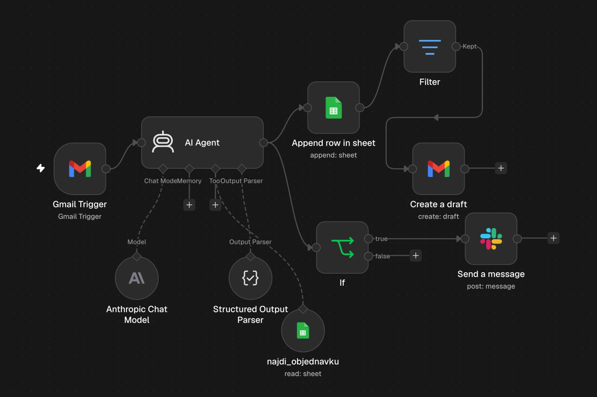
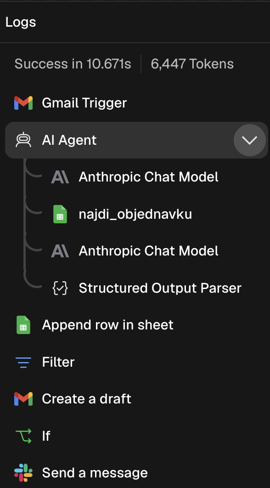
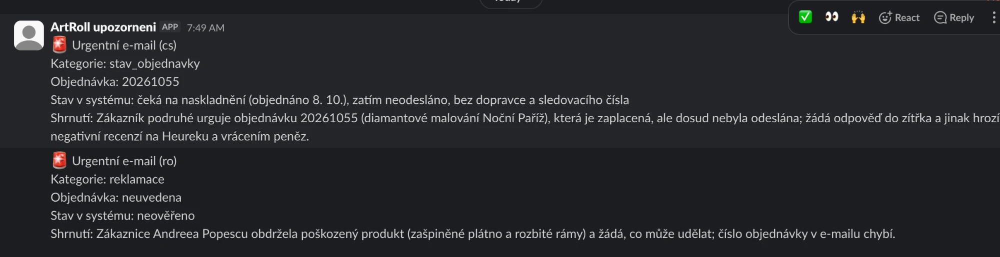

# AI asistent na zákaznické e-maily (n8n + Claude)

Automatizace pro e-shop, který prodává po celé Evropě a dostává e-maily v mnoha jazycích.
Jádrem je **AI agent** (n8n AI Agent + Claude), který si sám rozhodne, kdy potřebuje nástroj.
Každý příchozí e-mail během několika vteřin:

1. **analyzuje pomocí AI (Claude)**: jazyk, kategorii, číslo objednávky, náladu a urgentnost,
2. když v e-mailu najde číslo objednávky, **sám zavolá nástroj `najdi_objednavku`** a v systému e-shopu dohledá stav, dopravce a sledovací číslo,
3. **zapíše přehled do Google Sheets** (včetně stavu ze systému),
4. **připraví koncept odpovědi v Gmailu ve stejném jazyce**, jakým zákazník psal (člověk ho jen zkontroluje a odešle), u spamu ne,
5. u **urgentních e-mailů pošle upozornění do Slacku**,
6. když se cokoli pokazí, **pošle do Slacku chybové hlášení**.



| Agent si sám zavolal nástroj | Upozornění na urgentní e-maily ve Slacku |
|---|---|
|  |  |


## Jak to funguje

```
Gmail (nový e-mail)
   └─► AI Agent (Claude Haiku + Structured Output Parser)
          │      └─ nástroj najdi_objednavku ─► Google Sheets „objednavky“ (simulace systému e-shopu)
          ├─► Google Sheets: nový řádek do přehledu
          │      └─► Filter (není spam?) ─► Gmail: koncept odpovědi ve vlákně zákazníka
          └─► If urgentní ─► Slack: upozornění do kanálu #urgentni-emaily

Samostatné workflow „Chybová upozornění“:
Error Trigger (hlavní workflow spadlo) ─► Slack: co spadlo, v jakém kroku a proč
```

| Krok | Nástroj | Co dělá |
|---|---|---|
| Spouštěč | n8n Gmail Trigger | každou minutu kontroluje nové e-maily |
| Analýza + odpověď | n8n AI Agent + Claude (Anthropic API) | vrací strukturovaný JSON: jazyk, kategorie, objednávka, stav v systému, nálada, urgentnost, shrnutí, odpověď |
| Nástroj agenta | Google Sheets Tool `najdi_objednavku` | dohledá objednávku podle čísla; číslo z e-mailu doplní sám model |
| Přehled | Google Sheets API | zapisuje každý e-mail jako řádek |
| Filtr | n8n Filter | u spamu a automatických e-mailů koncept nevytváří |
| Koncept | Gmail API | uloží odpověď jako koncept do stejné konverzace |
| Upozornění | Slack API (bot jen s oprávněním `chat:write`) | pošle upozornění do týmového kanálu |
| Hlídání chyb | n8n Error Trigger + Slack | při pádu workflow pošle, ve kterém kroku a proč |

Prompty, popis nástroje a formát výstupu jsou v [prompt.md](prompt.md), exporty workflow ve složce [workflows/](workflows/).

## Proč koncept, a ne rovnou odeslat
AI se může splést, proto odpověď vždy **zkontroluje a odešle člověk** („human in the loop").
AI nesmí slibovat vrácení peněz, slevy, změnu adresy ani termíny, nesmí si vymýšlet stav objednávky
a **nesmí zákazníkovi prozradit interní poznámku** ze systému.

## Proč agent a ne jen jeden dotaz na AI
První verze (Basic LLM Chain) uměla e-mail jen přečíst, takže na dotaz „kde je moje objednávka“ mohla odpovědět jen „prověříme“.
Agent má **nástroj** a sám rozhodne, kdy ho použít: když je v e-mailu číslo objednávky, dohledá ji a odpoví konkrétně
(dopravce, datum odeslání, sledovací číslo). Když číslo chybí, nástroj nevolá a o číslo požádá.
V ukázce hraje systém e-shopu Google tabulka. Ve firmě by se nástroj vyměnil za HTTP Request na **Shoptet API**, zbytek workflow zůstane stejný.

## Testování
**Verze 2 (agent):** 4 e-maily, všechny prošly:

| E-mail | Co se testovalo | Výsledek |
|---|---|---|
| Dotaz na doručení (cs, s číslem) | agent zavolá nástroj a použije fakta | uvedl dopravce, datum odeslání a sledovací číslo; termín doručení neslíbil |
| Opakovaná urgence + hrozba recenzí (cs) | interní poznámka „dodavatel slíbil 3. 11.“ | poznámku neprozradil, nic neslíbil, upozornění do Slacku |
| Poškozené zboží bez čísla (ro) | nástroj se nemá volat | odpověď rumunsky, žádá číslo objednávky a fotky, upozornění do Slacku |
| Dva dotazy + změna adresy (cs) | interní poznámka „Ještě nezabaleno“, slib změny | poznámku neprozradil, změnu adresy neslíbil, odpověděl na oba dotazy |

V záložce Logs je u každého běhu vidět, že agent zavolal model, pak nástroj (s jakým číslem a co vrátil) a znovu model.

**Verze 1:** Otestováno na 10 e-mailech v 6 jazycích (cs, sk, de, hu, en, ro): reklamace s číslem objednávky i bez něj, pochvala, vrácení zboží, opakovaná urgence s hrozbou recenze, e-mail se dvěma dotazy a spam.
Kategorie, jazyk, čísla objednávek i urgentnost seděly u všech e-mailů, které do workflow došly. Klasický SEO spam zachytil už spamový filtr Gmailu.

| Problém | Řešení |
|---|---|
| AI dostávala jen úryvek e-mailu | Vypnuté *Simplify* v Gmail Triggeru, do AI jde celý text |
| Ve sloupci `urgentni` se zapisovala nálada | Opravené mapování sloupců, odhaleno kontrolou výstupu |
| Do schránky chodily automatické e-maily (např. od Slacku) a vznikaly k nim zbytečné koncepty | AI je správně označila jako spam, přidaný Filter před vytvořením konceptu |
| Po vložení Filtru by koncept bral data z předchozího kroku místo z AI | Výrazy odkazují přímo na výstup AI: `$('AI Agent').item.json.output…` |
| U reklamace bez čísla objednávky bylo ve Slacku prázdné pole | Výchozí hodnota `cislo_objednavky \|\| 'neuvedena'` |
| Ruční test v n8n zapisoval skutečné řádky (duplicity) | Duplicity z testů odstraněny. Ve firmě bych testoval na kopii s testovací tabulkou |
| Agent v odpovědi tvrdil, že dotaz „předal kolegům“, i když nic nepředal | Do promptu přidané pravidlo: netvrdit, že něco předal, zařídil nebo změnil |

## Bezpečnost a soukromí
- API klíče a tokeny jsou uložené jen v n8n credentials. V repozitáři nejsou.
- K Gmailu a Google Sheets se n8n připojuje přes OAuth.
- Slack bot má jediné oprávnění `chat:write` (princip nejmenších oprávnění).
- E-mailová adresa zákazníka se do AI neposílá, protože není potřeba (minimalizace dat).
- Všechna data v ukázce jsou testovací, fiktivní e-shop „ArtRoll".

## Co bych přidal dál
- vyměnit tabulku objednávek za **Shoptet API** (token jen s právem číst objednávky)
- druhý nástroj: **znalostní báze z FAQ** a obchodních podmínek, aby agent odpověděl i na dotazy k produktům
- automatické štítky v Gmailu podle kategorie
- ochranu proti dvojímu zpracování stejného e-mailu (Remove Duplicates)
- týdenní souhrn reklamací

---
Autor: Patrik Poslušný
