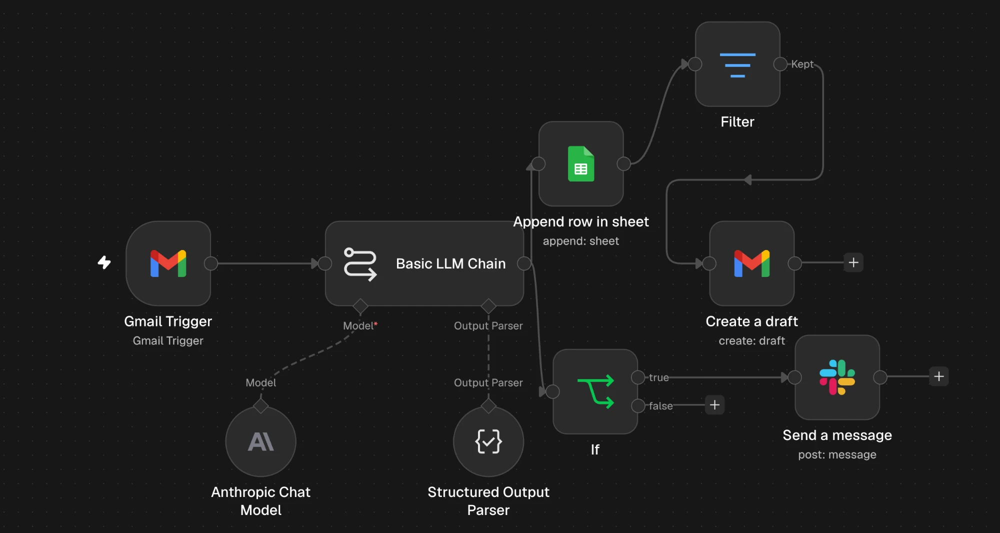

# AI asistent na zákaznické e-maily (n8n + Claude)

Automatizace pro e-shop, který prodává po celé Evropě a dostává e-maily v mnoha jazycích.
Každý příchozí e-mail během několika vteřin:

1. **analyzuje pomocí AI (Claude)**: jazyk, kategorii, číslo objednávky, náladu a urgentnost,
2. **zapíše přehled do Google Sheets**,
3. **připraví koncept odpovědi v Gmailu ve stejném jazyce**, jakým zákazník psal (člověk ho jen zkontroluje a odešle), u spamu ne,
4. u **urgentních reklamací pošle upozornění do Slacku**,
5. když se cokoli pokazí, **pošle do Slacku chybové hlášení**.




## Jak to funguje

```
Gmail (nový e-mail)
   └─► Claude (Basic LLM Chain + Structured Output Parser)
          ├─► Google Sheets: nový řádek do přehledu
          │      └─► Filter (není spam?) ─► Gmail: koncept odpovědi ve vlákně zákazníka
          └─► If urgentní ─► Slack: upozornění do kanálu #urgentni-emaily

Samostatné workflow „Chybová upozornění“:
Error Trigger (hlavní workflow spadlo) ─► Slack: co spadlo, v jakém kroku a proč
```

| Krok | Nástroj | Co dělá |
|---|---|---|
| Spouštěč | n8n Gmail Trigger | každou minutu kontroluje nové e-maily |
| Analýza + odpověď | Claude (Anthropic API) | vrací strukturovaný JSON: jazyk, kategorie, objednávka, nálada, urgentnost, shrnutí, odpověď |
| Přehled | Google Sheets API | zapisuje každý e-mail jako řádek |
| Filtr | n8n Filter | u spamu a automatických e-mailů koncept nevytváří |
| Koncept | Gmail API | uloží odpověď jako koncept do stejné konverzace |
| Upozornění | Slack API (bot jen s oprávněním `chat:write`) | pošle upozornění do týmového kanálu |
| Hlídání chyb | n8n Error Trigger + Slack | při pádu workflow pošle, ve kterém kroku a proč |

Prompty a formát výstupu jsou v [prompt.md](prompt.md), exporty workflow ve složce [workflows/](workflows/).

## Proč koncept, a ne rovnou odeslat
AI se může splést, proto odpověď vždy **zkontroluje a odešle člověk** („human in the loop").
AI nesmí slibovat vrácení peněz, slevy ani termíny a nesmí si vymýšlet stav objednávky.

## Testování
Otestováno na 10 e-mailech v 6 jazycích (cs, sk, de, hu, en, ro): reklamace s číslem objednávky i bez něj, pochvala, vrácení zboží, opakovaná urgence s hrozbou recenze, e-mail se dvěma dotazy a spam.
Kategorie, jazyk, čísla objednávek i urgentnost seděly u všech e-mailů, které do workflow došly. Klasický SEO spam zachytil už spamový filtr Gmailu.

| Problém | Řešení |
|---|---|
| AI dostávala jen úryvek e-mailu | Vypnuté *Simplify* v Gmail Triggeru, do AI jde celý text |
| Ve sloupci `urgentni` se zapisovala nálada | Opravené mapování sloupců, odhaleno kontrolou výstupu |
| Do schránky chodily automatické e-maily (např. od Slacku) a vznikaly k nim zbytečné koncepty | AI je správně označila jako spam, přidaný Filter před vytvořením konceptu |
| Po vložení Filtru by koncept bral data z předchozího kroku místo z AI | Výrazy odkazují přímo na výstup AI: `$('Basic LLM Chain').item.json.output…` |
| U reklamace bez čísla objednávky bylo ve Slacku prázdné pole | Výchozí hodnota `cislo_objednavky \|\| 'neuvedena'` |
| Ruční test v n8n zapisoval skutečné řádky (duplicity) | Duplicity z testů odstraněny. Ve firmě bych testoval na kopii s testovací tabulkou |

## Bezpečnost a soukromí
- API klíče a tokeny jsou uložené jen v n8n credentials. V repozitáři nejsou.
- K Gmailu a Google Sheets se n8n připojuje přes OAuth.
- Slack bot má jediné oprávnění `chat:write` (princip nejmenších oprávnění).
- E-mailová adresa zákazníka se do AI neposílá, protože není potřeba (minimalizace dat).
- Všechna data v ukázce jsou testovací, fiktivní e-shop „ArtRoll".

## Co bych přidal dál
- napojení na **Shoptet API**, aby asistent znal skutečný stav objednávky
- znalostní bázi z FAQ a obchodních podmínek, aby odpovědi byly přesnější
- automatické štítky v Gmailu podle kategorie
- ochranu proti dvojímu zpracování stejného e-mailu (Remove Duplicates)
- týdenní souhrn reklamací

---
Autor: Patrik Poslušný
